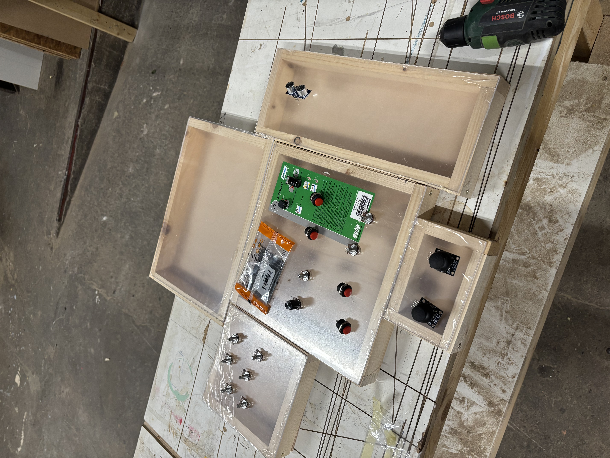

# Modules

## Core

### Inputs

- 4 Knobs
- 4 Buttons
- 1 Encoder
  - Scene selection
  - reset / pause time
- 1 Special Button
  - reset / pause time

### Board

- Controller ESP32-S3 Pico
- USB connection
- Analog Multiplexer
- Input Shift Register (SPI)
- Connections to the other modules
- 4 Button on `SR1 CORE`
- 1 Special Button on `SR1 CORE`
- 2 Encoder Directoin on `SR1 CORE`

## Joystick

### Inputs

- 2 Joysticks

### Board

_use Analog Multiplexer included in `Core`_

- 2x 2 = 4 Analog in `MP1 CORE`
- 2x 1 = 2 Digital directly onto the controller `GP41` and `GP42`

### Connector

- 2 Pin Power
- 6 Pin
  - 2 Digital Button
  - 4 Analog Potentiometers

## Knobs

### Inputs

- 9 Potentiometers

### Board

- Analog Multiplexer `MP2 KNOBS`

### Connector

- 6 Pin
  - 4bit Address (shared)
  - Enable
  - Signal (shared)
- 2 Pin Power

## Sliders

### Inputs

- 7 Sliders

### Board

- Analog Multiplexer `MP3 SLIDE`

### Connector

- 6 Pin
  - 4bit Address (shared)
  - Enable
  - Signal (shared)
- 2 Pin Power

## Distance

### Inputs

- 4 Distance Sensors

### Board

- Shift Register `SR2 DIST`

### Connector

- 6 Pin
  - 1 Trig (shared)
  - 4 Echo
  - 1 unused
- 2 Pin Power
