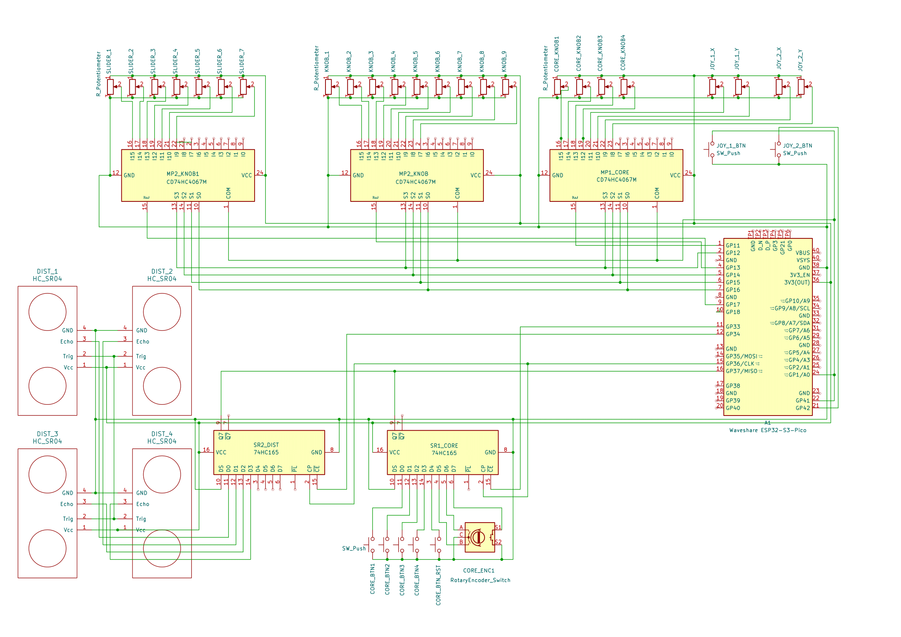

# Pinout

## Controller

`ESP32-S3-Pico`

| Usage     | ADC        | Name       | Pin | USB | Pin | Name   | Usage         |
| --------- | ---------- | ---------- | --- | --- | --- | ------ | ------------- |
|           |            | `VBUS`     |  40 |     |   1 | `GP11` | `MP1 CORE`    |
|           |            | `VSYS`     |  39 |     |   2 | `GP12` | `S3`          |
| PWR GND   |            | `GND`      |  38 |     |   3 | `GND`  |               |
|           |            | `3V3_EN`   |  37 |     |   4 | `GP13` | (`MP2 KNOB`)  |
| PWR VCC   |            | `3V3(OUT)` |  36 |     |   5 | `GP14` | `S2`          |
|           | `ADC1_CH9` | `GP10`     |  35 |     |   6 | `GP15` | `S1`          |
| I²C `SCL` | `ADC1_CH8` | `GP9`      |  34 |     |   7 | `GP16` | `S0`          |
|           |            | `GND`      |  33 |     |   8 | `GND`  |               |
| I²C `SDA` | `ADC1_CH7` | `GP8`      |  32 |     |   9 | `GP17` | (`MP3 SLIDE`) |
|           | `ADC1_CH6` | `GP7`      |  31 |     |  10 | `GP18` |               |
|           |            | `RUN`      |  30 |     |  11 | `GP33` | (`SR1 CORE`)  |
|           | `ADC1_CH5` | `GP6`      |  29 |     |  12 | `GP34` | (`SR2 DIST`)  |
|           |            | `GND`      |  28 |     |  13 | `GND`  |               |
|           | `ADC1_CH4` | `GP5`      |  27 |     |  14 | `GP35` | `SPI MOSI`    |
|           | `ADC1_CH3` | `GP4`      |  26 |     |  15 | `GP36` | `SPI CLK`     |
|           | `ADC1_CH1` | `GP2`      |  25 |     |  16 | `GP37` | `SPI MISO`    |
| `SIG`     | `ADC1_CH0` | `GP1`      |  24 |     |  17 | `GP38` |               |
|           |            | `GND`      |  23 |     |  18 | `GND`  |               |
| (`JOY1`)  |            | `GP41`     |  22 |     |  19 | `GP39` |               |
| (`JOY2`)  |            | `GP42`     |  21 |     |  20 | `GP40` |               |

## Analog Bus

`CD74HC4067M` (read)

| Usage             | Pin `CD74HC4067M` |        Pin `ESP32` |
| ----------------- | -----------------:| ------------------:|
| Adress (shared)   |              `S0` |             `GP16` |
| Adress (shared)   |              `S1` |             `GP15` |
| Adress (shared)   |              `S2` |             `GP14` |
| Adress (shared)   |              `S3` |             `GP12` |
| Signal (shared)   |             `SIG` | `ADC1_CH0` / `GP1` |
| Enable MP1_Core   |              `EN` |             `GP11` |
| Enable MP2_Knob   |              `EN` |           (`GP13`) |
| Enable MP1_Slider |              `EN` |           (`GP17`) |

## Digital Bus: SPI

`74HC165` (read), `74HC959` (write)

| Usage                 |   Pin `74HC165` |    Pin `74HC959` |       Pin `ESP32` |
| --------------------- | ---------------:|  ---------------:|------------------:|
| `SCK` Clock (shared)  |           `CLK` |          `SRCLK` |            `GP36` |
| `MOSI` Write (shared) |             --- |            `SER` |            `GP35` |
| `MISO` Read (shared)  |           `Q_H` |              --- |            `GP37` |
| Enable SR1_Core       |       `CLK INH` |              --- |          (`GP33`) |
| Enable SR2_Distance   |       `CLK INH` |              --- |          (`GP34`) |
|                       |                 |             `OE` |                   |

TODO what is the latch pin?
